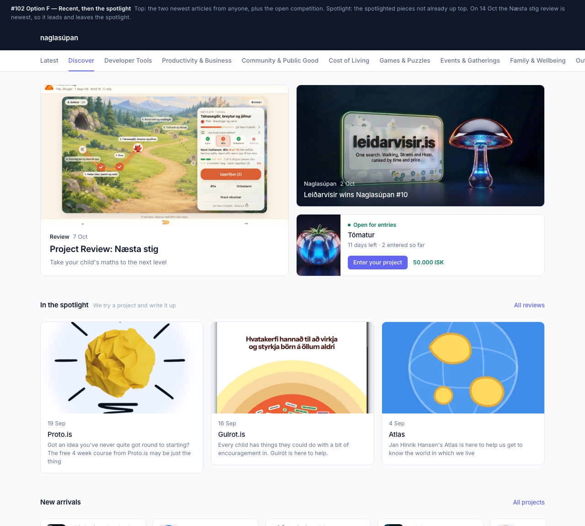

# Discover page redesign

Closes the design side of #102 and takes a position on #101's sibling
question of what the landing page is for. The agreed layout is in
[`docs/mockups/2026-10-14-discover-redesign/`](mockups/2026-10-14-discover-redesign/discover.html),
rendered from production data captured on 2026-10-14:

## The layout

The top of the page is organised by kind of communication, in three tiers.
Below them the existing sections stay as they are.

| Tier | Holds | Status |
|---|---|---|
| **Recent** | The two newest articles from anyone, plus the open competition | Build |
| **In the spotlight** | Spotlighted articles not already shown in Recent | Build |
| **Opinion** | Editorial pieces, columns | Later — nothing to fill it yet |
| New arrivals, Competition winners, Recent tipoffs, category rows | Unchanged | — |

Recent uses the 1 + 2 grid `FeaturedSection` has today: the newest article is
the large card, the second newest sits top-right, and the open competition takes
the bottom-right slot. The competition is drawn as state with a verb — open,
days left, entries so far, prize, *Enter your project* — not as an article
card, because it is not one.

**The Latest page and tab are dropped.** Recent is the window onto new
writing; a second chronological view of the same stream is not worth a tab.

### Why this shape

- **The slots fill from different pools, so none can starve.** Recent is fed
  by anyone's articles; the competition slot by `/api/competitions/highlights`;
  the spotlight by the spotlighted set. A project's or a person's article enters
  Recent on the same terms as a house post, because Recent is ordered by date
  alone. Earlier passes split the page by *source* (house vs community) and
  ended up with sections that would sit empty until community writing existed.
- **The competition slot cannot go stale.** Eleven monthly rounds so far;
  there is always one open or just closed. An article-fed slot could not promise
  that — on 2026-10-14 the feed still showed "voting open until Friday" two
  weeks after voting closed.
- **The dedupe does work on day one.** The newest article on 2026-10-14 is
  itself a review, so it leads the page and the spotlight shows the next three
  rather than repeating it.

### Rules

- **Recent** — the two newest globally visible articles, any project, any
  channel. `Article.objects.globally_visible()` is the filter; this is one
  ordered query.
- **Slot 3** — the first competition in `accepting_applications`; failing that
  the one in `voting` (verb becomes *Rank the entries*); failing that the most
  recently closed round with its winner. `GET /api/competitions/highlights`
  (`api/routers/competitions.py:76`) already returns competitions in that order
  but not the winner — see below.
- **Spotlight** — spotlighted articles minus those already in Recent, newest
  first, up to three. Dedupe by article id. If only one is left, show one; the
  heading is what tells a reader the house writes reviews.
- **Spotlighted** means an explicit flag on `Article`, not the `Reviews`
  channel. A channel is the author's distribution choice; the spotlight is the
  house's editorial choice, and they diverge the moment a project other than the
  house writes something worth putting there. Today the two sets are identical,
  so the flag is bootstrapped from the channel.

## What we'd need to do

Suggested as four changes in this order. Each leaves the site working; the
first is invisible.

### 1. Backend: the three data sources

- **`Article.is_spotlight`** — boolean, default false, admin list filter and
  toggle. Data migration sets it on every globally visible article on the house
  project's `Reviews` channel (4 as of 2026-10-14). *Migration.*
- **`GET /api/articles/recent?limit=2`** and **`GET /api/articles/spotlight?limit=5`**
  — both `globally_visible()`, ordered `-published_at`, returning an
  `ArticleListItem` plus `project_slug`/`project_title` so the card can link and
  carry its kicker. Spotlight over-fetches to five so the client can drop up to
  two already shown and still fill three.
- **Winner on the closed round.** Add `winner: WinnerProjectResponse | None`
  to `CompetitionSummaryResponse` for closed competitions, so the slot-3
  fallback is one request. `get_competition` already `select_related("winner")`;
  reuse the image resolution from `REPO.project.list_winners`.
- Router tests for all three; `make extract-openapi` and commit
  `backend-openapi.json` (the backend's `make extra-tests` fails otherwise).

### 2. Frontend: the top two tiers

- `DiscoverView`: replace `FeaturedSection` with `RecentSection` (1 + 2) and
  add `SpotlightSection`. The small article card already exists as
  `SmallHeroCard`; the competition card is new and should reuse
  `getCompetitionDeadline` and the status vocabulary from
  `CompetitionStatusBadge` rather than restate them.
- `projects/page.tsx`: fetch `recent`, `spotlight`, `highlights`; drop
  `fetchFeaturedProjects`.
- A pure `selectDiscoverTop(recent, spotlight, highlights)` in `src/lib/` with
  vitest coverage for: dedupe; one spotlight item left; no open competition →
  voting → closed-with-winner; fewer than two recent articles.
- Article listing images carry a `listing_crop`; `FeedRow` already renders it —
  lift that into a shared `ListingImage` before `FeedRow` is deleted in step 3.
- Strings go in `src/i18n/projects/en.json` (#108 moved UI copy behind
  next-intl). New keys: `recent.*`, `spotlight.*`, `competitionSlot.*`.
- `make extra-tests` in `web-ui` checks per-route bundle budgets after the
  build; the projects route gains one card component and should stay inside.

### 3. Drop Latest, then the feed

Nothing reads `GET /api/feed` except the Latest page, and nothing reads
`apps.feed` except that endpoint, its admin, and its signals. Two commits:

1. **Page and tab.** Delete `src/web-ui/src/app/latest/`, `lib/api/feed.ts`
   and the `fetchFeed*` helpers in `lib/api/server.ts`; remove the `latest`
   tab and `ListingTab` kind from `ListingTabs`; remove `/latest` from
   `sitemap.ts` (its coverage test will tell you); delete `src/i18n/feed/` and
   `projects.listingTabs.latest`. `use-leave-guard.test.tsx` uses `/latest`
   only as an arbitrary href — leave it.
2. **The app.** Delete `apps/feed` (model, two migrations, signals, admin, the
   `backfill_feed` command), `services/feed`, `api/routers/feed.py`, the
   `FEED_LEAD_FRESHNESS_DAYS` setting, and the "Promote to the Latest feed"
   action in `apps/discussions/admin.py`. *Migration — drops `feed_feedevent`.*
   Pin, retire and promote state on existing events is lost; the stream itself
   was derivable (that is what `backfill_feed` did), the curation was not. If
   anyone wants a record of what was pinned, export it before this lands.

### 4. Retire `Project.is_featured`

Once the spotlight is article-driven nothing on the page reads it. Remove the
field (*migration*), `list_featured`, `GET /api/projects/featured`, the admin
column, and `fetchFeaturedProjects`; regenerate the OpenAPI spec.

## Open questions

- **Mobile order.** The 1 + 2 grid stacks to a column. Lead, second article,
  competition — or lead, competition, second article, so the verb is above the
  fold? The mockup takes no position.
- **Below the fold.** This assumes New arrivals, Competition winners, Recent
  tipoffs and the category rows stay as they are. Say so if not.
- **Feed curation loss** in step 3 — confirm it is acceptable before the
  table is dropped.

When implementation starts, open an OpenSpec change (`opsx:new
redesign-discover-front`) and move the breakdown above into its `tasks.md`;
this doc stays as the rationale.
